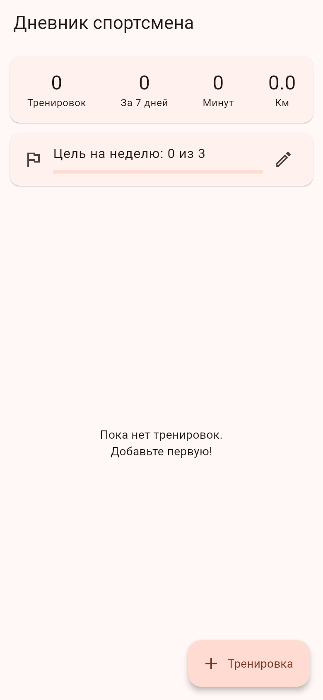
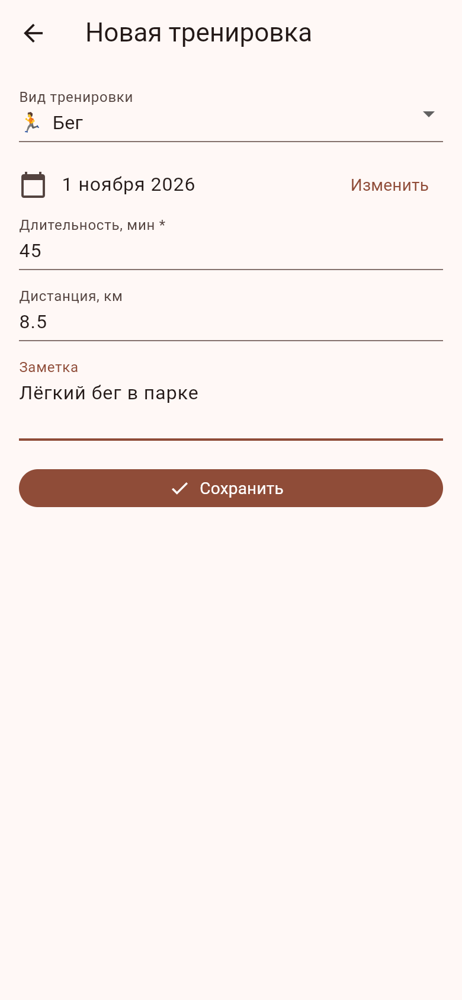
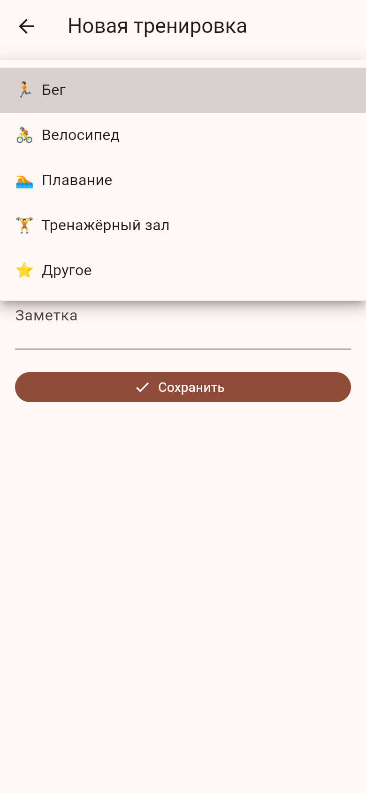
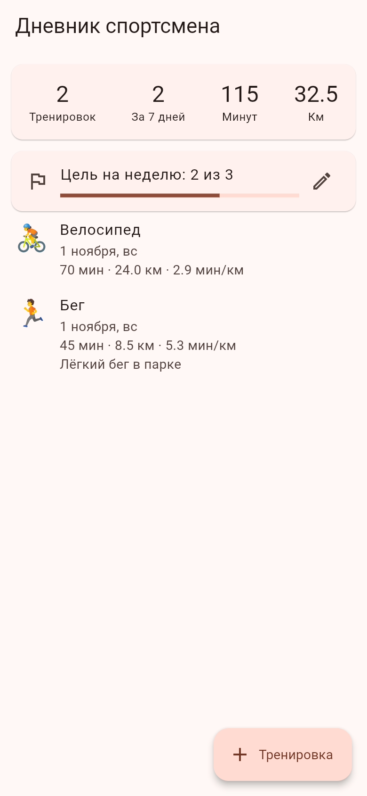
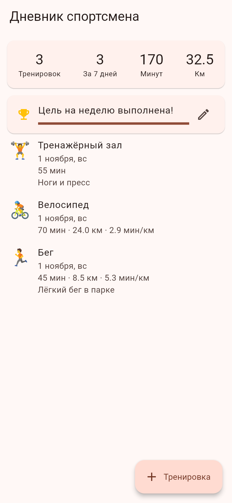
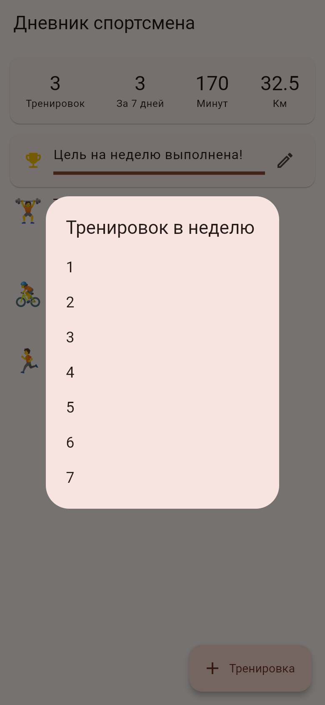

# Дневник спортсмена

Мобильное приложение на Flutter для учёта тренировок. Делается как учебный проект.

Идея простая: спортсмен записывает свои тренировки (бег, вело, плавание, зал и т.д.), видит историю и базовую статистику за неделю.

## MVP

Что должно быть в первой версии:

- [x] Добавление тренировки: вид, дата, длительность, дистанция (необязательно), заметка
- [x] Список тренировок, новые сверху
- [x] Удаление тренировки (свайп влево)
- [x] Статистика на главном экране: всего тренировок, за последние 7 дней, сумма минут и километров
- [x] Расчёт темпа (мин/км), если указана дистанция
- [ ] Сохранение данных на устройстве (сейчас всё хранится только пока открыто приложение)
- [ ] Редактирование тренировки
- [ ] Фильтр по виду тренировки
- [x] Цель на неделю (например, 3 тренировки) и прогресс по ней, цель можно поменять нажатием

Возможно потом: графики по неделям, профиль спортсмена, тёмная тема.

## Скриншоты

Главный экран и добавление тренировки:

  

Список тренировок и цель на неделю:

  

## Структура

```
lib/
  main.dart                  - точка входа
  models/workout.dart        - модель тренировки
  data/workout_store.dart    - хранилище и подсчёт статистики
  screens/home_screen.dart   - главный экран (статистика + список)
  screens/add_workout_screen.dart - форма добавления
test/
  workout_store_test.dart    - тесты статистики
```

## Запуск

Нужен установленный Flutter SDK.

Платформенные папки (android, ios и т.д.) в репозиторий не добавлены, перед первым запуском их нужно сгенерировать:

```
flutter create . --project-name athlete_diary
flutter pub get
flutter run
```

Тесты:

```
flutter test
```
